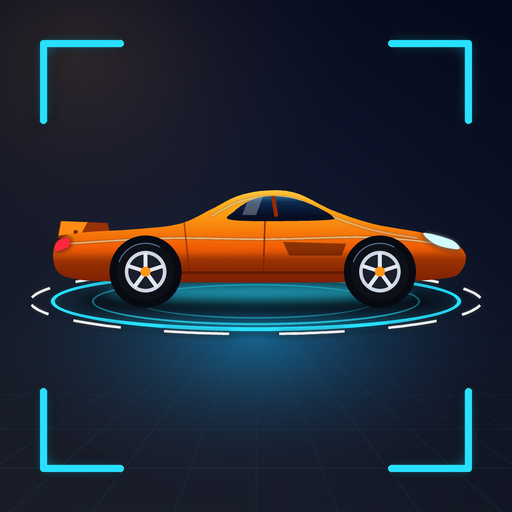
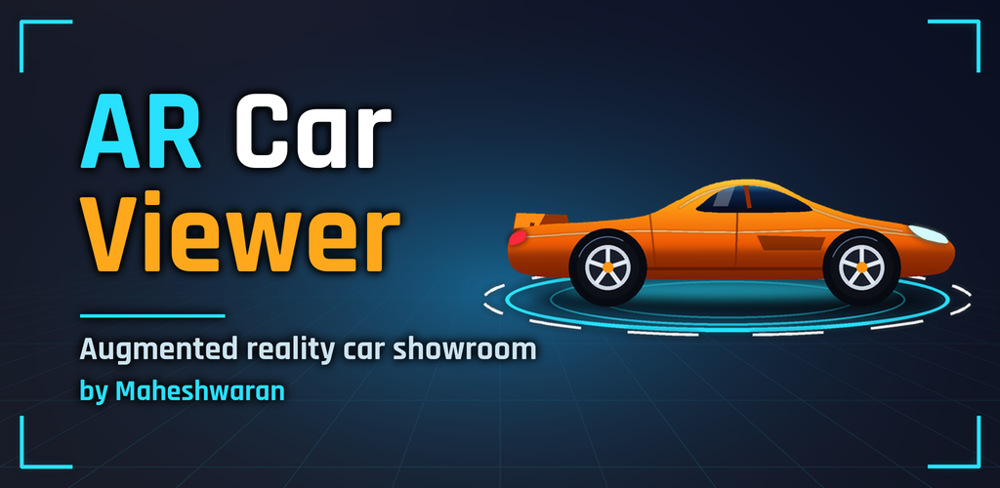

# AR Car Viewer



**Augmented reality car showroom for Android.** Point your phone at the floor or a table, tap to place a car at real-life size, then walk around it, repaint it, take it apart and listen to a voice tour.

Made by Maheshwaran.



## Features

- **Real-world placement.** ARCore plane detection finds floors and tables. A cyan reticle shows where the car will land; tap to place it, tap again to move it. The car is fitted to about 1.2 m long by default.
- **Gestures.** Pinch to scale (0.1x to 1.5x of life size), drag one finger sideways to rotate, or switch on auto-rotate.
- **Paint.** Five paint swatches, including the original yellow.
- **Explode view.** The body, spoiler and wheels glide apart and back together in 0.6 s, relative to the car, so it works at any size and position.
- **Voice tour.** Play or pause the narration; the button icon and a progress panel follow the state.
- **Info card.** A short spec sheet (sample showroom values, labelled as demo data).
- **About panel.** Version, author and credits.
- **Planes on/off and Reset.** Hide the detected-surface overlay or start over.
- **Friendly errors.** Clear messages when ARCore is not supported or camera access is denied.
- **Modern portrait UI.** Safe-area aware, rounded midnight/graphite panels with amber and cyan accents, TextMeshPro with the Rajdhani font.

## How to use

1. Open the app and tap **Start**. Allow camera access when asked.
2. Move the phone slowly until the floor or table is detected.
3. Aim the ring at the surface and tap to place the car.
4. Pinch to scale, drag to rotate, tap elsewhere on the surface to move the car.
5. Use the bottom bar: Paint, Explode, Spin, Voice, Planes, Reset.

## Requirements

- Android 8.0 (API 26) or newer, 64-bit (ARM64).
- A device that supports [Google ARCore](https://developers.google.com/ar/devices) and has Google Play Services for AR installed.
- To build: Unity 6000.6.2f1 with Android Build Support (SDK, NDK and OpenJDK).

## Build

Open the project in Unity 6000.6.2f1, or build from the command line (headless):

```powershell
# One-time scene, font, materials and player settings
Unity.exe -batchmode -nographics -quit -projectPath . -buildTarget Android `
  -executeMethod CarViewer.Editor.CarViewerBuild.SetupProject -logFile Logs/setup.log

# Build the APK -> Builds/Android/ARCarViewer-1.0.0.apk (debug signing)
Unity.exe -batchmode -nographics -quit -projectPath . -buildTarget Android `
  -executeMethod CarViewer.Editor.CarViewerBuild.BuildAndroid -logFile Logs/build.log
```

Key settings: IL2CPP, ARM64, minimum API 26, OpenGL ES 3, ARCore "Required", portrait.

## Project structure

```
Assets/
  CarViewer/
    Scripts/   C# runtime code (namespace CarViewer)
    Editor/    CarViewerBuild: scene setup and Android build
    Fonts/     Rajdhani Bold + OFL licence, TMP font asset
    Icon/      App icon, adaptive icon layers, logo
    Scenes/    Main.unity (generated by SetupProject)
  ARCADE - FREE Racing Car/   Car model (third-party)
  external asset/             Narration audio
Docs/          Store graphics
```

Main scripts: `ARCarApp` (start-up and UI), `ARPlacementController` (planes, reticle, gestures), `CarModel` (fit, paint, explode), `VoiceTour`, `XRCameraPoseDriver`.

## Credits

- Author: **Maheshwaran** - [github.com/MAHESH21723](https://github.com/MAHESH21723)
- Car model: "ARCADE - FREE Racing Car" from the Unity Asset Store, by its author (see the asset's own licence).
- Voice tour: generated with ElevenLabs.
- Font: [Rajdhani](https://fonts.google.com/specimen/Rajdhani), SIL Open Font License 1.1 (`Assets/CarViewer/Fonts/OFL-Rajdhani.txt`).
- Built with Unity, AR Foundation and Google ARCore.

## License

The source code is released under the [MIT License](LICENSE). Third-party assets (the car model, the font, the narration audio and Unity packages) keep their own licences.
